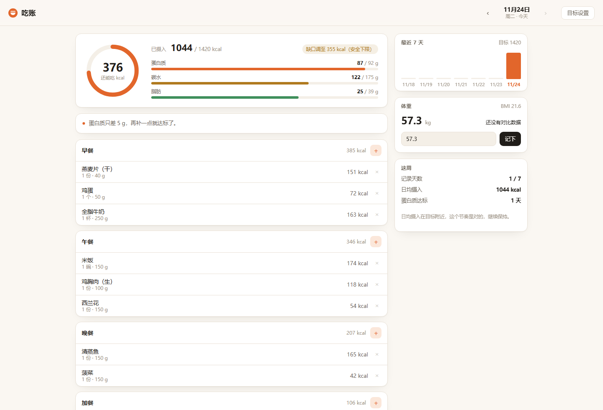
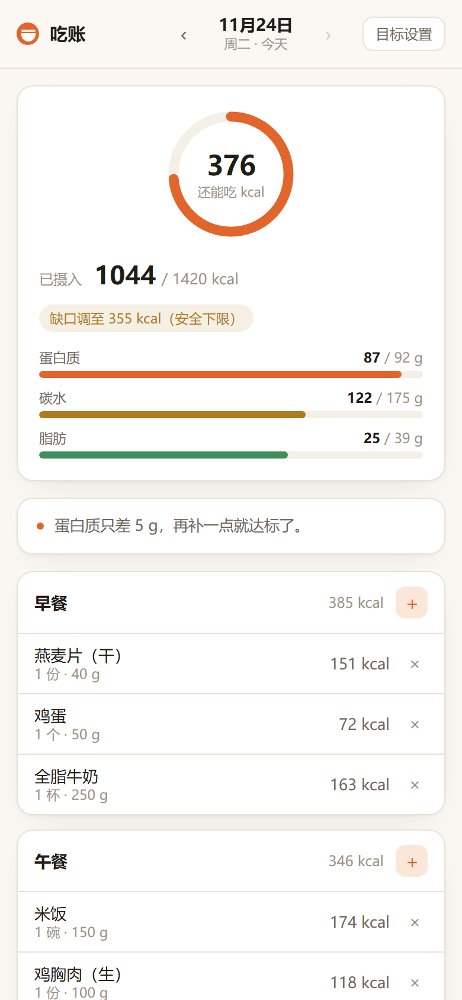
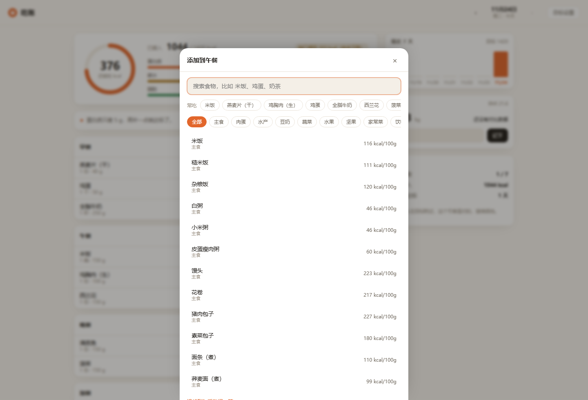

# 吃账 · chizhang

> 一条命令启动的减脂饮食记录工具。拖进去吃了什么，它算出热量、蛋白质和还能吃多少。
> 零依赖、纯本地、不用注册、数据不离开你的电脑。

```bash
cd chizhang && python -m chizhang
```

浏览器自动打开，然后点任意一餐的 `＋` 开始记。



## 为什么又做一个饮食记录工具

因为大部分 App 要你注册、要联网、要塞广告，或者一个食物库分成免费版和会员版。而减脂这件事其实只需要几个数字：**今天吃了多少热量、蛋白质够不够、离目标还差多少**。

这个工具就干这几件事，用 Python 标准库写，没有 pandas、没有 npm、没有构建步骤。`git clone` 完直接跑。

## 它做什么

**记录比计算更简单。** 搜"米饭"，出来一堆常见份量——一碗 150 g、小碗 100 g、半碗 75 g。点一下就记完了，不用拿厨房秤。找不到的菜可以手动填热量，会存下来以后复用。

**每天只剩两个数字要看。** 圆环里是"还能吃多少"，下面三条是蛋白质、碳水、脂肪的进度。超了就变红，不用自己算。

**蛋白质优先。** 减脂最容易掉的不是体重而是肌肉。所以目标里蛋白质按 1.6 g/kg 体重算，比普通膳食指南高——这是保住肌肉的剂量。

**它会给一句话建议。** 不是"继续加油"这种废话，而是"蛋白质只差 5 g，再补一点就达标了"或者"超出目标 320 kcal，大约要慢走 91 分钟才能抵掉"。

**体重趋势不撒谎。** 每天记一次，看 7 天变化而不是单日波动——水分涨落比脂肪快得多，只看单日容易被吓到或骗到。

| 手机界面 | 搜索食物 |
|---|---|
|  |  |

## 热量目标是怎么算出来的

不是拍脑袋给的数字，每一步都能查：

| 步骤 | 公式 | 举例（28 岁女性，163 cm，58 kg，每周运动 1–3 次） |
|---|---|---|
| 基础代谢 BMR | Mifflin-St Jeor | 1298 kcal |
| 每日消耗 TDEE | BMR × 1.375 | 1785 kcal |
| 目标热量 | TDEE − 缺口（默认 400） | 1385 → **上调到 1428** |
| 蛋白质 | 1.6 g × 体重 | 93 g |
| 脂肪 | 目标的 25% | 39 g |
| 碳水 | 剩下的热量 | 175 g |

**为什么会被"上调"？** 因为 1385 kcal 低于 `基础代谢 × 1.1` 的安全下限。长期吃不够基础代谢，身体会降代谢、掉肌肉，减下来的体重反弹得更快。工具会自动把目标抬到下限，并在界面上标出来——这是它有意识地不让你做的事。

界面上的每个数字（BMR、TDEE、缺口、BMI）在「目标设置」里都能看到来源，改身高体重会立刻重算。

## 数据存在哪

```
~/.chizhang/store.json
```

一个普通的 JSON 文件，随时可以打开看、复制走、扔进 Git。写入是原子的（先写临时文件再替换），断电不会把记录写坏。文件损坏时会另存一份 `.corrupt.json` 再重来，不会静默清空。

在「目标设置」底部可以**导出备份**，格式就是原样的 JSON。

## 手机上用

记饮食最好的时机是刚吃完，那时候手机在手边。让手机和电脑连同一个 WiFi，然后：

```bash
python -m chizhang --lan
```

终端会打印一个 `http://192.168.x.x:8770/` 的地址，手机浏览器打开即可。Android 可以在浏览器菜单里「添加到主屏幕」，用起来和 App 差不多。数据还是存在你电脑上那一份。

> `--lan` 会把服务暴露到局域网。不要在公共 WiFi 下用。

## 食物库

内置 170 种常见中餐食物，每 100 g 的热量、蛋白质、碳水、脂肪，加上中国人实际会用的份量单位（碗、个、份、勺、把）。

覆盖主食、肉蛋、水产、豆奶、蔬菜、水果、坚果、家常菜、饮料零食、油脂调味十类，包括米饭面条馒头、番茄炒蛋、红烧肉、宫保鸡丁、麻辣烫、火锅、珍珠奶茶这些真正会吃的东西。

数值参考《中国食物成分表（第 6 版）》和 USDA 数据库，做了取整。

**这是估算，不是实验室测量。** 同一道"红烧肉"，家里做和饭店做的热量能差一倍——油和糖的差别比肉本身大。工具的价值在于让你知道量级和趋势，不在于精确到个位数。

## 命令行

```bash
python -m chizhang                     # 默认 127.0.0.1:8770，自动开浏览器
python -m chizhang --port 9000         # 换端口
python -m chizhang --lan               # 允许手机访问
python -m chizhang --data ./my.json    # 指定数据文件
python -m chizhang --no-browser        # 不自动开浏览器
```

装成命令后用 `chizhang` 代替 `python -m chizhang`：

```bash
pip install .
chizhang
```

## HTTP 接口

界面上的每个操作都是一次请求，接口可以单独用：

```bash
curl -s "localhost:8770/api/state" | python -m json.tool
curl -s "localhost:8770/api/foods?q=鸡蛋"
curl -s localhost:8770/api/entries -X POST \
  -H 'Content-Type: application/json' \
  -d '{"date":"2026-11-24","meal":"lunch","food_id":"f000","grams":150}'
curl -s "localhost:8770/api/report?days=7"
```

| 方法 | 路径 | 作用 |
|---|---|---|
| GET | `/api/state?date=` | 某天的完整状态（目标、三餐、周报、体重） |
| GET | `/api/foods?q=&category=` | 搜索食物 |
| POST | `/api/entries` | 加一条记录 |
| DELETE | `/api/entries/{id}` | 删一条记录 |
| POST | `/api/weights` | 记体重 |
| POST | `/api/profile` | 改身体数据与目标 |
| GET | `/api/export` | 导出全部数据 |
| POST | `/api/import` | 导入备份 |

## 开发

```bash
python -m unittest discover -s tests -v
```

79 个测试，覆盖营养计算、食物库数据一致性、全部 HTTP 路由。其中有几条测试专门防"数据录入错误"——比如用 `4×蛋白 + 4×碳水 + 9×脂肪` 反推每种食物的标称热量，偏差超过 30% 就报错。这类错一旦进了库里，用户看到的建议就全错了。

`health.py` 里全是纯函数：不碰网络、不碰文件，输入身体数据和记录，输出热量与营养素。所以能直接对着手算结果断言——`BMR = 10×55 + 6.25×165 − 5×30 − 161 = 1270.25`，测试就断言这个数。

## 免责

这是一个记录工具，不是医疗建议。孕期、哺乳期、有慢性病或在服药的人，饮食方案请找医生或注册营养师。目标热量设得再合理，也不代表适合每一个人。

## License

MIT
